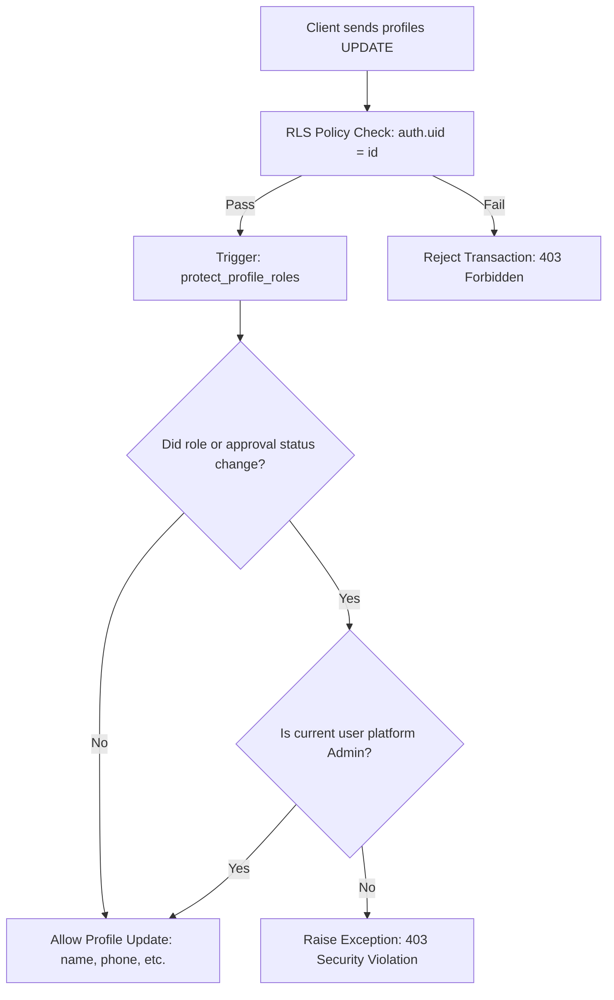
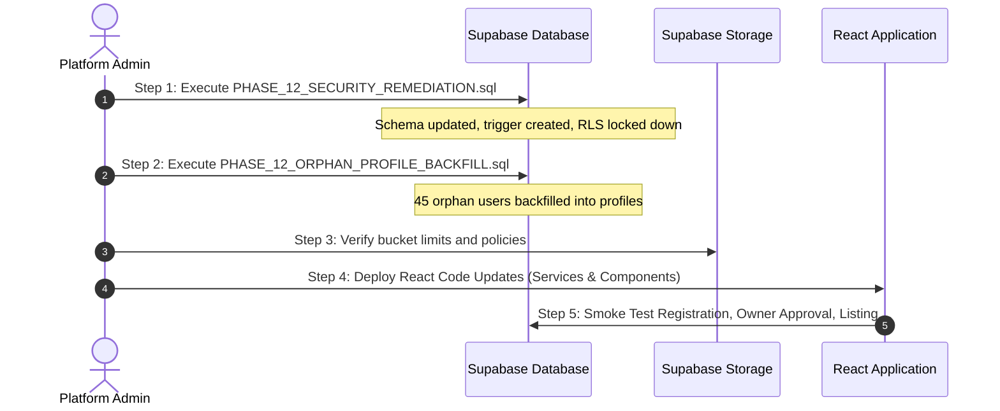

# Roomdhundo — Phase 12: Comprehensive Security Remediation Plan

**Document:** `PHASE_12_SECURITY_REMEDIATION_PLAN.md`  
**Status:** Prepared for Architecture & Security Review (Non-Destructive)  
**Date:** November 16, 2026  
**Context:** Remediates vulnerabilities identified in `LIVE_SUPABASE_SECURITY_AUDIT.md`  

---

## 1. Executive Summary & Context

The live audit of the Roomdhundo Supabase instance confirmed critical security flaws and architectural mismatches:
- **Privilege Escalation:** Authenticated users could self-elevate to `admin` via `profiles.update({ role: 'admin' })`.
- **Profile Data Exposure:** Overly permissive policy `"Admin read profiles"` leaked all user emails, full names, and roles to any logged-in user.
- **Orphan Users & Broken Login Flow:** The absence of `handle_new_user()` trigger left 45 registered accounts orphaned in `auth.users`, locking out email owners and hiding users from Admin &rarr; Users.
- **Listing & Owner Email Privacy Leaks:** Public `SELECT` policy (`qual: true`) exposed all 36 unapproved properties and plain-text `owner_email` addresses.
- **Storage Vulnerabilities:** No folder isolation or MIME/size restrictions existed in `property-images`.
- **Schema Mismatches:** Frontend services query nonexistent columns (`listing_status`, `phone`) and nonexistent tables (`bookings`).

This remediation plan establishes a **defense-in-depth architecture** enforcing authorization and privacy at the Postgres database layer, while detailing the exact frontend code changes required for compatibility.

---

## 2. Architecture & Design Decisions

### 2.1 Profile Security & Anti-Privilege Escalation Model
- **The Vulnerability:** In Postgres RLS, `WITH CHECK` clauses on `UPDATE` evaluate only the proposed new row values. They do not compare `NEW.role` with `OLD.role`. A policy like `WITH CHECK (auth.uid() = id)` allows the user to submit `{ id: auth.uid(), role: 'admin' }`, which Postgres permits.
- **The Solution:** A `BEFORE UPDATE` trigger (`protect_profile_roles()`) on `public.profiles`. The trigger compares `OLD.role` vs `NEW.role` and `OLD.owner_approval_status` vs `NEW.owner_approval_status`. If a non-admin attempts to change either column, the trigger raises a Postgres exception and aborts the transaction.
- **RLS Policy Tightening:**
  - Drop `"Admin read profiles"` (`qual: true`).
  - Users can read only their own profile (`auth.uid() = id`).
  - Only administrators can read all profiles (`public.roomdhundo_is_admin()`).



---

### 2.2 Owner Approval Lifecycle
- **Field:** `public.profiles.owner_approval_status`
- **Values:** `'pending'` (default for owners), `'approved'`, `'rejected'`.
- **Renters:** Stored with `owner_approval_status = NULL` (renters do not require listing approval).
- **Enforcement:**
  - Database RLS policies on `buildings` and `room_types` require `public.is_approved_owner() OR public.roomdhundo_is_admin()`.
  - Frontend route guards (`ProtectedRoute.jsx`) check both role and approval status, redirecting pending owners to an informative onboarding view.

---

### 2.3 Building Dual-Status Architecture (Publication vs Verification)
- **The Problem:** The live `buildings` table contains only `status` (`pending`, `approved`, `rejected`), representing Admin Verification. The frontend expects a separate publication state (`listing_status`) representing Owner Intent (`draft`, `published`, `archived`).
- **The Solution:**
  1. Add column `listing_status text NOT NULL DEFAULT 'published' CHECK (listing_status IN ('draft', 'pending', 'published', 'archived'))` to `public.buildings`.
  2. A building is publicly visible **if and only if**:
     `status = 'approved' AND listing_status = 'published'`
  3. Owners can view all their listings (`auth.uid() = created_by`).
  4. Admins can view all listings (`public.roomdhundo_is_admin()`).

---

### 2.4 Owner Email Privacy Architecture
- **The Constraint:** Postgres RLS evaluates whole rows, not individual columns. If a public visitor can `SELECT` from `buildings`, any column on that table is readable unless restricted. Column-level `REVOKE SELECT` is ineffective if table-level `SELECT` is granted.
- **The Chosen Design:** **Private Owner Contact Table (`public.building_owner_contacts`)**
  - Table schema: `(building_id uuid PK, owner_id uuid, owner_email text, owner_phone text, created_at timestamptz)`.
  - RLS on `building_owner_contacts`: Only the property owner (`auth.uid() = owner_id`) and administrators can `SELECT` or modify.
  - Public visitors have **zero access** to `building_owner_contacts`.
  - On `public.buildings`, `owner_email` is set to `NULL` (redacted).
  - This guarantees that public listing scraping can never expose owner email addresses.

---

### 2.5 Storage Architecture & Folder Isolation
- **Bucket:** `property-images` (Public read allowed for image serving).
- **Folder Convention:** Enforce standard `${userId}/*` path convention.
- **RLS Policies on `storage.objects`:**
  - `INSERT`: `bucket_id = 'property-images' AND auth.uid()::text = (storage.foldername(name))[1]`
  - `UPDATE`: `bucket_id = 'property-images' AND auth.uid()::text = (storage.foldername(name))[1]`
  - `DELETE`: `bucket_id = 'property-images' AND (auth.uid()::text = (storage.foldername(name))[1] OR roomdhundo_is_admin())`
- **Bucket Limits:** Enforce 50 MB file size limit and strict image/video MIME types (`image/jpeg`, `image/png`, `image/webp`, `video/mp4`).

---

## 3. Code-Level Remediation Requirements

The following frontend code files require updates to align with the database security remediation:

### 3.1 `src/services/admin/adminService.js`
- **Schema Column Alignment:**
  - Line 84: Query `status` and `listing_status` instead of `verification_status`.
  - Line 220–226: Update `status: normalized` (and `listing_status: 'published'`) instead of `verification_status`.
- **Server-Side Pagination & User Directory Completeness:**
  - Replace unpaginated client-side query in `fetchAdminProfiles()` with server-side range queries, exact role filtering, and search.

```javascript
// BEFORE (Unpaginated, client-filtered, queries nonexistent phone column)
export async function fetchAdminProfiles(options = {}) {
  const { data, error } = await supabase
    .from("profiles")
    .select("*")
    .order("created_at", { ascending: false });
  // Client-side filtering...
}

// AFTER (Server-side paginated, exact count, sanitized search)
export async function fetchAdminProfiles({
  roleFilter = "all",
  searchQuery = "",
  page = 1,
  pageSize = 20,
} = {}) {
  if (!supabase) return { data: [], totalCount: 0, error: new Error("Supabase unconfigured") };

  const from = (page - 1) * pageSize;
  const to = from + pageSize - 1;

  let query = supabase
    .from("profiles")
    .select("id, full_name, email, role, owner_approval_status, created_at, phone", { count: "exact" })
    .order("created_at", { ascending: false })
    .range(from, to);

  if (roleFilter && roleFilter !== "all") {
    query = query.eq("role", roleFilter.toLowerCase());
  }

  if (searchQuery && searchQuery.trim()) {
    const q = searchQuery.trim();
    query = query.or(`full_name.ilike.%${q}%,email.ilike.%${q}%`);
  }

  const { data, count, error } = await query;
  return {
    data: data || [],
    totalCount: count || 0,
    page,
    totalPages: Math.ceil((count || 0) / pageSize),
    error,
  };
}
```

---

### 3.2 `src/services/auth/index.js`
- **Profile Column Selection:**
  - In `fetchUserProfile()` (line 86), update column selection to include `owner_approval_status`:
    `select("id, full_name, email, role, owner_approval_status, created_at, phone")`
- **Prevent Unsafe Upsert Override:**
  - In `upsertUserProfile()`, ensure `owner_approval_status` is not modified by regular users.

---

### 3.3 `src/services/properties/index.js`
- **Public Query Filtering:**
  - In `fetchPublishedProperties()` (line 244), add database-level filters:
    ```javascript
    let query = supabase
      .from("buildings")
      .select("*, room_types(*), reviews(*)")
      .eq("status", "approved")
      .eq("listing_status", "published")
      .order("created_at", { ascending: false });
    ```
  - This eliminates reliance on client-side filtering and ensures only approved, published listings are requested.

---

### 3.4 `src/services/owner/index.js`
- **Listing Payload Alignment:**
  - Lines 392–393: When creating a new listing, set:
    ```javascript
    status: "pending",               // Admin verification status
    listing_status: "published",     // Owner publication intent
    ```
- **Owner Contact Storage:**
  - Upon successful building creation, insert owner contact information into `public.building_owner_contacts`.

---

### 3.5 `src/services/bookings/index.js`
- **Decouple from Nonexistent `bookings` Table:**
  - The live database contains only `hotel_bookings`. The generic `bookings` table does not exist.
  - Guard calls to `fetchUserBookings` and `createRoomReservationBooking` to cleanly indicate that PG/Flat direct reservations are scheduled for future release, while keeping `hotel_bookings` fully operational.

---

### 3.6 `src/components/auth/ProtectedRoute.jsx`
- **Owner Approval Check:**
  - When accessing owner-only routes (`/owner/*`), check if `profile?.role === 'owner'`.
  - If `profile?.owner_approval_status === 'pending'`, display an informative message: *"Your owner account is awaiting administrator review. Once verified, you will be able to manage properties."*
  - If `profile?.owner_approval_status === 'rejected'`, display a clear notice.

---

## 4. Admin Users Completeness & Pagination

### 4.1 Root Causes of Previous User Invisibility
1. **Missing Profile Records (45 Users):** Email registrations created auth records in `auth.users` without triggering `public.profiles` insertions.
2. **Missing Server-Side Pagination:** Loading all profiles in one unpaginated request risked silent truncation at PostgREST's 1,000-row limit.

### 4.2 Full Resolution Strategy
1. **Automated Future Profiles:** Trigger `on_auth_user_created` calls `handle_new_user()` on every auth signup.
2. **Orphan Account Recovery:** Migration script `PHASE_12_ORPHAN_PROFILE_BACKFILL.sql` backfills all 45 existing orphan accounts.
3. **UI Enhancements (`AdminUsersPage.jsx` & `AdminUserTable.jsx`):**
   - Display total registered user count from `{ count: 'exact' }`.
   - Add pagination controls (Previous / Next / Page Jump).
   - Display `owner_approval_status` badge for owner accounts (`Pending Review`, `Approved`, `Rejected`).
   - Add Quick Approval / Rejection action buttons for admins to moderate owner applications directly from the table.

---

## 5. Deployment Execution Plan



### Pre-Deployment Verification:
1. Verify Supabase connection string and execution credentials.
2. Confirm current row counts: `auth.users` (164), `public.profiles` (119), `public.buildings` (36).
3. Ensure no active user registration session is in progress during migration window.

### Step-by-Step Execution:
1. **Step 1:** Execute `PHASE_12_SECURITY_REMEDIATION.sql` in Supabase SQL Editor.
   - Run verification queries at end of script.
   - Confirm `protect_profile_roles` trigger and `handle_new_user` trigger are active.
2. **Step 2:** Execute `PHASE_12_ORPHAN_PROFILE_BACKFILL.sql`.
   - Verify remaining orphans count = 0.
   - Verify total `public.profiles` = 164.
3. **Step 3:** Deploy React application updates.
4. **Step 4:** Execute post-deployment smoke tests.

---

## 6. Risk Matrix & Rollback Protocols

| Risk | Likelihood | Impact | Mitigation Strategy |
| :--- | :--- | :--- | :--- |
| **Existing owner listings hidden** | Medium | High | Script sets existing 18 owners to `owner_approval_status = 'approved'` and existing buildings to `listing_status = 'published'`. |
| **Email signup failure** | Low | High | `handle_new_user()` contains an internal exception handler with `RAISE WARNING` to ensure `auth.users` insertion never fails. |
| **Frontend query rejection** | Low | Medium | Schema adds `listing_status` and `phone` columns to match frontend expectations. |
| **Admin lockout** | Very Low | Critical | Scripts explicitly preserve existing admin ID `413afa03-fe04-4402-8844-e61c91148245` and enforce `ON CONFLICT DO UPDATE` role protection. |

### Rollback Protocol:
If unexpected behavior occurs post-migration:
1. **RLS Rollback:** Revert RLS policies using the statements provided in Section 10 of `PHASE_12_SECURITY_REMEDIATION.sql`.
2. **Trigger Disabling:** If profile synchronization issues arise, run:
   `DROP TRIGGER IF EXISTS on_auth_user_created ON auth.users;`
3. **Data Safety:** Never drop or truncate `public.profiles` or `public.buildings`. All existing records remain intact.

---
*End of Remediation Plan.*
